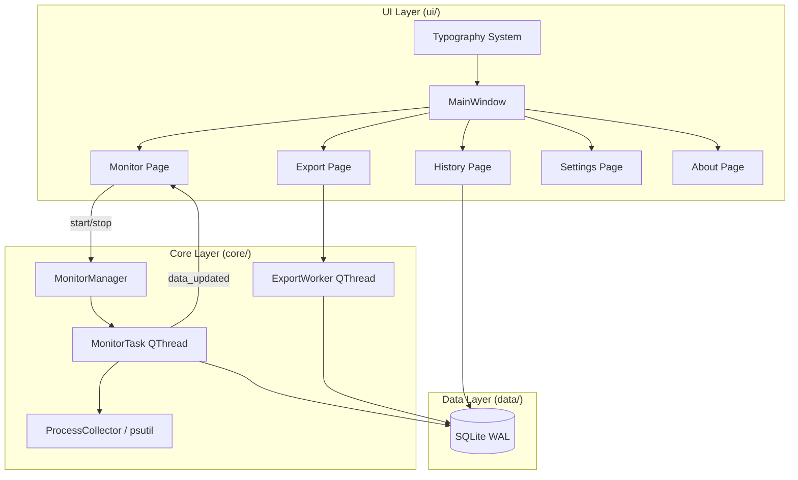

<div align="center">

# ProcessMonitor

A lightweight Windows desktop tool for real-time per-process resource monitoring, history visualization and CSV export.

[](https://github.com/liujialu0330/ProcessMonitor/actions/workflows/ci.yml)
[](https://github.com/liujialu0330/ProcessMonitor/releases)
[](https://github.com/liujialu0330/ProcessMonitor/releases)
[](https://github.com/liujialu0330/ProcessMonitor)
[](https://github.com/liujialu0330/ProcessMonitor)
[](./LICENSE)

English | [简体中文](./README.zh-CN.md)


</div>

ProcessMonitor is a Windows 11 Fluent Design desktop app for keeping an eye on any running process. Pick a process by PID or from a live list, choose from 26 metrics across memory, CPU, system and I/O categories, and watch the numbers update on a configurable sampling interval — from every second up to once an hour. Every sample is persisted locally, so you can replay it as a chart, browse it as a table, or export it to CSV for further analysis.

## ✨ Features

### 🧭 Recommended workflow: hunting leaks

1. On the Monitor page, pick the target process. The default "Leak check" preset (private bytes, handles, GDI objects, USER objects, threads) is pre-selected and your last choice is remembered; add a test note if you like, then start.
2. Let the target warm up to a steady state, then click "Marker" on the task card and label it "baseline".
3. After each round of the operation under test (e.g. open and close a window N times), add another marker describing what you just did.
4. On the History page, look at the marker lines on the chart and at the stats strip's "Change" and "Growth rate" (per hour, least-squares slope). A value that climbs after every round and never falls back is the classic leak signature.

### 🔍 Monitoring
- **26 metrics, 4 categories** — memory (working set, private bytes, page faults, USS, ...), CPU (usage, user/kernel time, priority), system (threads, handles, GDI/USER objects, voluntary context switches) and I/O (read/write bytes and counts); every metric has a one-line description, shown as a tooltip in the metric picker
- **Private bytes as the leak indicator** — the former "virtual memory", "commit size" and "private working set" metrics were identical on Windows and are merged into "private bytes", the primary metric for spotting memory leaks
- **Honest gaps instead of fake zeros** — when a metric cannot be read, the task card shows "unavailable" with the reason and nothing is recorded for it. Without administrator rights only USS of higher-privilege processes is unreadable; GDI/USER objects of processes in other sessions (e.g. system services) show "not supported"
- **Change since start and full-run trend** — each card shows every metric's change since the task began, and the sparkline covers "task start until now" (automatically thinned out on long runs)
- **Markers and notes** — attach a test note to a task and drop labelled markers on a running task to record key actions; stopping a task asks for confirmation
- **Careful task creation** — no process is pre-selected, creating a second task for the same PID asks for confirmation, and the process list can be searched by name or PID
- **Multi-metric, multi-task** — any metric combination per task, sharing one interval and timestamp; up to 5 running tasks at once (the quota counts running tasks only); any integer interval from 1 to 3600 seconds, default 1s
- **Pause & resume** — pause a task without losing history; resuming samples immediately
- **Cards stay after a task ends** — a finished card offers "View history", "Monitor again" and "Close"; if the target process ends unexpectedly you get an in-app notice, plus a tray balloon when the window is in the background
- **Steady sampling** — scheduled on a monotonic-clock deadline so it does not drift over time, does not backfill after the machine sleeps, and detects PID reuse so a new process is never mistaken for the original

### 📊 History & Export
- **Focused history workspace** — shows "All" data by default (leak analysis needs the whole run), with quick 10m / 1h / 6h / 24h ranges and separate Trend / Details views; the task dropdown shows duration, note and a "running" marker
- **Stats strip** — start, current, change, growth rate (per hour), min and max
- **Interactive history charts** — hover crosshair with readout, a real date/time axis and marker lines; Y-axis ticks are rounded in the display unit, count metrics use integer ticks, and a flat curve is not blown up into full-height noise; export to PNG or copy to the clipboard
- **Auto-refresh for running tasks** — chart and stats follow the live data, with a refresh interval that adapts to the data volume
- **Large-data friendly** — charts are bucketed on the database side (up to 2,000 buckets, min/max per bucket, so peaks and valleys survive); the detail table shows "latest 2,000 / N total" while exports are always complete
- **Wide-format CSV export** — one row per sample, one column per metric, and a final "Marker" column; counts in the task info use thousands separators, switching task resets the default file name, and overwriting an existing file asks first; it writes a temporary file and replaces the target only on success, so a cancelled or failed export never leaves a half-written file; runs in the background and can be cancelled
- **Controlled cleanup** — delete a finished task from the History page's More menu, with confirmation; database cleanup and compaction are unavailable while any task is running

### ⚙️ Settings & Personalization
- **Theme** — light, dark, or follow the system, switches instantly
- **Consistent typography** — Segoe UI / Microsoft YaHei UI type stack, 24px page titles and monospaced data labels
- **Defaults & retention** — default sampling interval and a history retention policy (forever / 7 / 30 / 90 / 180 days)
- **Database maintenance** — see disk usage and clean up + compact in one click
- **System tray and close behavior** — optionally minimize to tray on close and keep monitoring; closing the window while tasks are running asks "Stop and exit / Minimize to tray / Cancel" (skipped on logoff or shutdown)
- **Single instance** — launching the app again activates the open window instead of starting a second copy

### 🛡 Reliability & Security
- **Auto-update** — checks GitHub Releases on startup (or on demand) with a non-modal notice; downloads are restricted to official GitHub hosts and the installer's SHA-256 is verified, and if no checksum is published you are pointed to the release page for a manual download
- **Crash-resilient storage** — SQLite with WAL mode, automatic retry on failed writes, crash/error logging (5MB x 5 rotation), and automatic recovery of orphaned "running" tasks after an unclean shutdown
- **Safe database upgrades** — upgrades run in an explicit transaction and roll back on failure, restoring from the automatic backup so old data is never lost
- **Never freezes on stop** — stopping a task or exiting the app does not block the UI, and all collected data is flushed to disk before exit
- **Automated test suite** — 400+ test cases covering the data layer, migration, collection and scheduling, export, update verification, page flows and UI contracts; tests use a temporary data directory and never touch real data
- **Measured performance** — opening a 770k-row history task takes ~1.4s (down from 3.4s pre-v1.2.0; measured on the maintainer's dev machine)

## 📸 Screenshots

| Real-time Monitoring | History Data |
|---|---|
|  |  |

| Data Export | Settings & About |
|---|---|
|  | <br> |

## 🚀 Getting Started

### For Users

1. Grab the latest installer from [Releases](https://github.com/liujialu0330/ProcessMonitor/releases) — `Windows_v*_Setup.exe`
2. Run it and follow the setup wizard (custom install directory supported)
3. Launch **ProcessMonitor** from the Start Menu

Installing a new version over an existing install keeps your history data.

### For Developers

```bash
git clone https://github.com/liujialu0330/ProcessMonitor.git
cd ProcessMonitor
pip install -r requirements.txt
python main.py
```

### Notes

- **System requirements**: Windows 10/11 (64-bit); Python 3.8+ to run from source (CI and release builds use 3.11)
- **Data storage**: `%LOCALAPPDATA%\进程监控助手\data\monitor.db` (SQLite, WAL mode); logs live under `%LOCALAPPDATA%\进程监控助手\logs\`
- **Auto-update**: checks GitHub Releases on startup and from the About page; you can download and run the installer without leaving the app

## 🏗 Architecture

ProcessMonitor is built with PyQt5 + PyQt-Fluent-Widgets for the UI, psutil for process metrics, pyqtgraph for charts, and SQLite for storage. It follows a layered design — UI, core business logic and data — connected through Qt signals/slots to keep cross-thread communication safe.



## 🛠 Development

```bash
python -m pytest tests/
```

- List the test cases with `pytest --collect-only -q`; tests use a temporary data directory by default, and the runtime data directory can be overridden with the `PROCESS_MONITOR_DATA_DIR` environment variable (logs then go to its `logs\` subfolder)
- CI runs the test suite on every push and pull request (see the CI badge above)
- To build a Windows installer, see [build/README_打包说明.md](build/README_打包说明.md)

## 🗺 Roadmap

- [ ] Export history data to Excel format
- [ ] Multi-process comparison view

See [CHANGELOG.md](./CHANGELOG.md) or [GitHub Releases](https://github.com/liujialu0330/ProcessMonitor/releases) for the full release history.

## 🤝 Contributing

Issues and pull requests are welcome. Please make sure `python -m pytest tests/` passes and CI is green before submitting a PR.

## 📄 License

Released under the [MIT License](./LICENSE).

Maintained by [liujialu](https://github.com/liujialu0330).
