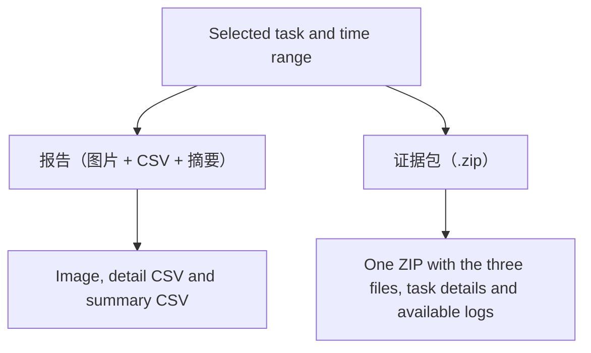

# ProcessMonitor

Track memory, handles, and GDI objects in Windows processes. Mark each test round to see where usage keeps growing and export evidence.

**[Download for Windows](https://github.com/liujialu0330/ProcessMonitor/releases/latest)** · Windows 10/11 (64-bit)

[Quick start](#quick-start) · [Command line](#command-line) · [简体中文](README.zh-CN.md)

## Quick start

Download `Windows_v*_Setup.exe` from the **Assets** section and run it. Open **进程监控助手** from the Start menu. [Latest release](https://github.com/liujialu0330/ProcessMonitor/releases/latest)


1. **Start monitoring.** In **监控** (Monitor), find the process by name or PID. For your first run, choose **泄漏排查** (leak investigation) and select **开始监控**.
2. **Mark the baseline and rounds.** Let the process settle, select **打点** on its task card, and accept **基线** (Baseline). Repeat an operation such as opening and closing the same window. Add a marker after each round.
3. **View the results.** Select **分析** while monitoring or **查看分析** after stopping. Read **判定摘要** (Verdict summary), then select a row in **打点区间** (Marker intervals) to focus the chart on that interval.


## Read the results

| What you want to check | How to read it |
| --- | --- |
| How much usage changed | **较基线** in the verdict summary shows the change from baseline. |
| Which rounds added to usage | Compare **Δ** across marker intervals. Repeated increases give you a pattern to reproduce. |
| Why the verdict says **数据不足** | Trend analysis needs at least 30 valid samples spanning the longer of 10 minutes or 30 sampling intervals. |

### See small changes in memory

Open **分析 → 采集明细** (Analysis → Sample details) and set **内存单位** (Memory unit) to **KB**. Auto shows all three totals as 2 GB. The KB view shows the values below, and **较上次** formats each change by its own magnitude.

| Sample private bytes in KB | **较上次** (Change since previous sample) |
| ---: | ---: |
| 2,098,624 KB | +32 KB |
| 2,098,656 KB | +32 KB |
| 2,098,688 KB | +32 KB |


## Export evidence

Choose a task and time range in Analysis. Once the results have loaded, open **导出报告** (Export report).



Choose a save location. Select **打开文件夹** (Open folder) when the export finishes.

## Command line

Open PowerShell in the installation directory and replace `1234` with your target PID. This records private bytes and handles, adds a marker each minute, and saves an evidence ZIP to your user folder after about 15 minutes.

```powershell
.\pmctl.exe run --pid 1234 --metrics "memory_private,num_handles" --interval 1 `
  --rounds-every 60 --stop-after 900 `
  --evidence "$env:USERPROFILE\ProcessMonitorReports"
```

The command-line switch is under **设置 → 监控默认值 → 允许命令行与脚本控制**. [Waiting for launch, process groups and exit codes](tools/README.md)

## Documentation

| For | Read |
| --- | --- |
| Version history and upgrades | [Changelog](CHANGELOG.md) · [Releases](https://github.com/liujialu0330/ProcessMonitor/releases) |
| Time ranges, metrics and report fields | [Product guide](doc/PRD_进程监控助手.md) |
| Source layout and Windows packaging | [Architecture](doc/代码架构说明.md) · [Build guide](build/README_打包说明.md) |

The v2.0.4 installer includes memory-unit switching and marker renaming from the interval table. [2.0.4 release notes](doc/2.0.4发布说明.md)

<details>
<summary>Run from source and test</summary>

Run from the repository root with Python 3.11.

```powershell
python -m pip install -r requirements-lock.txt
python main.py
```

Run the same functional test selection as CI.

```powershell
python -m pip install -r requirements-dev.txt
$env:QT_QPA_PLATFORM = 'offscreen'
$env:QT_QPA_FONTDIR = 'C:\Windows\Fonts'
$env:PYTHONIOENCODING = 'utf-8'
python -m pytest tests/ -m "not perf and not soak and not gui_real"
```

</details>

[Report an issue](https://github.com/liujialu0330/ProcessMonitor/issues) · [MIT License](LICENSE)
