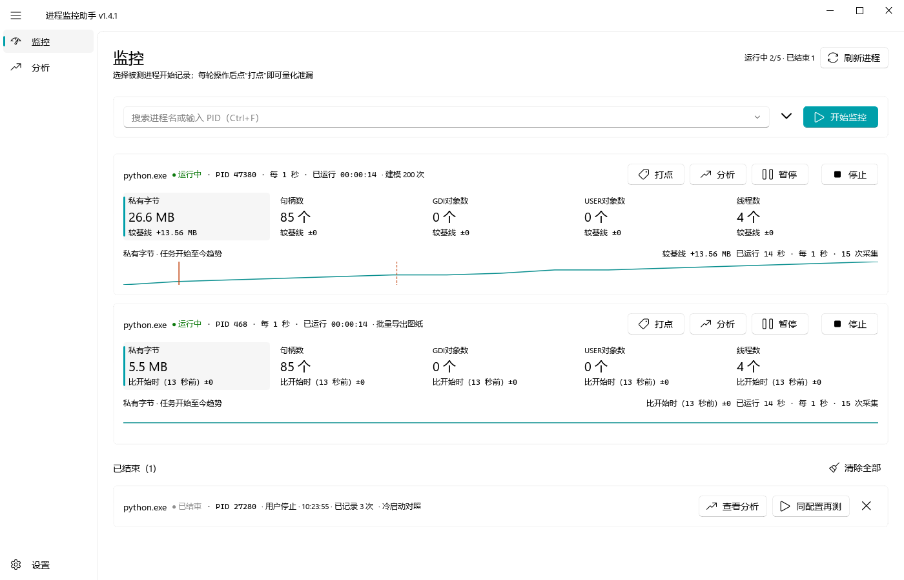
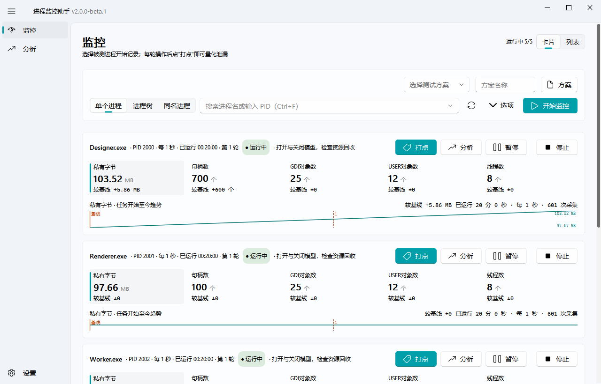
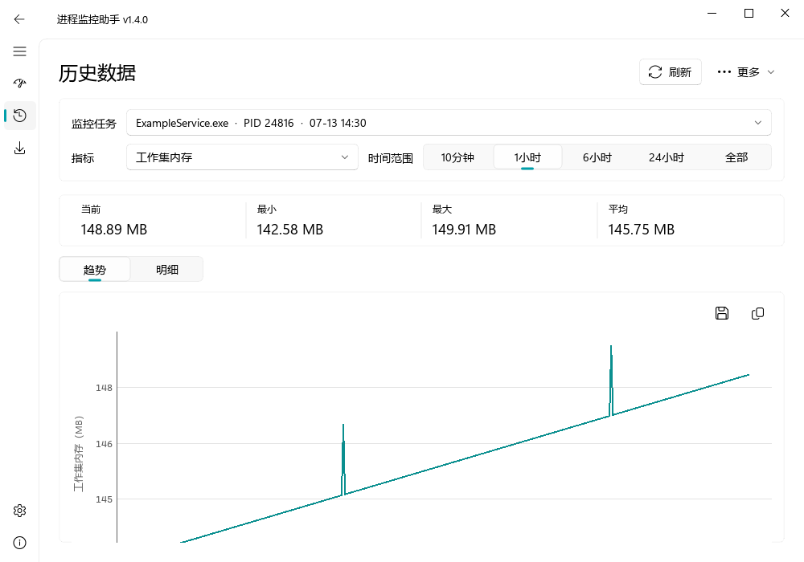
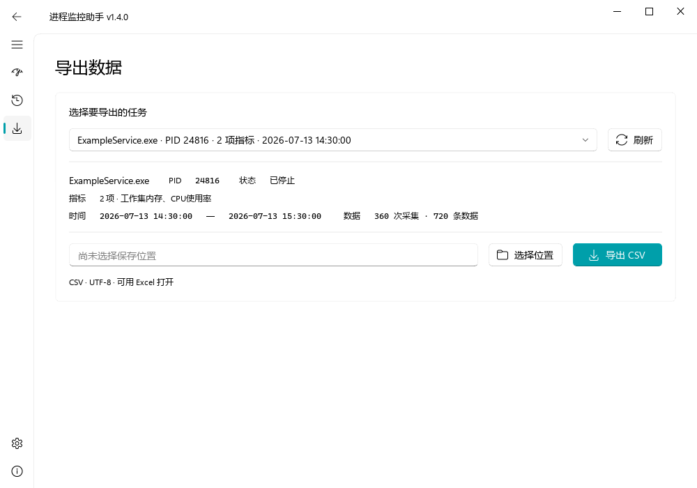
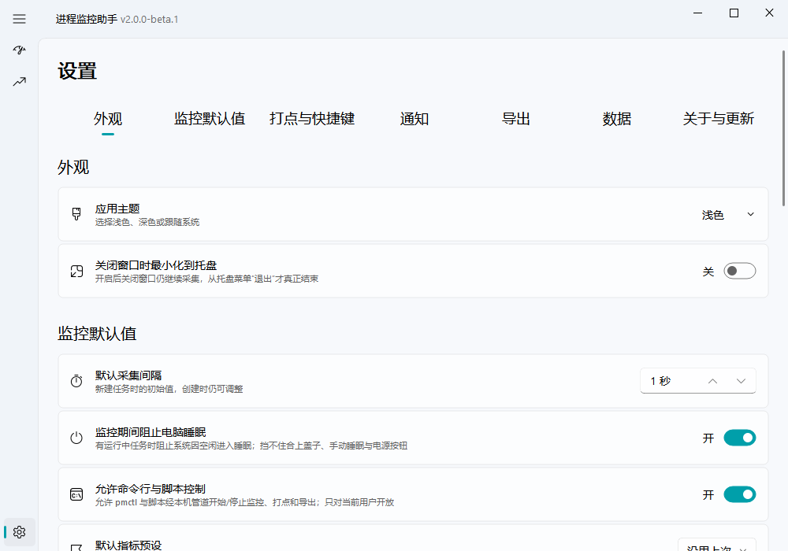
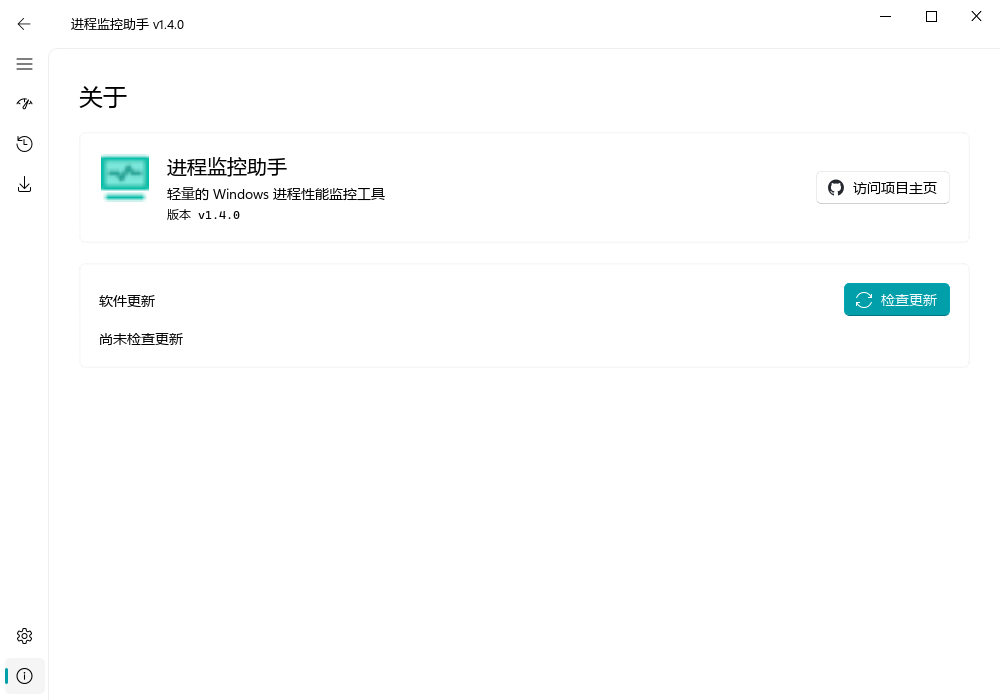
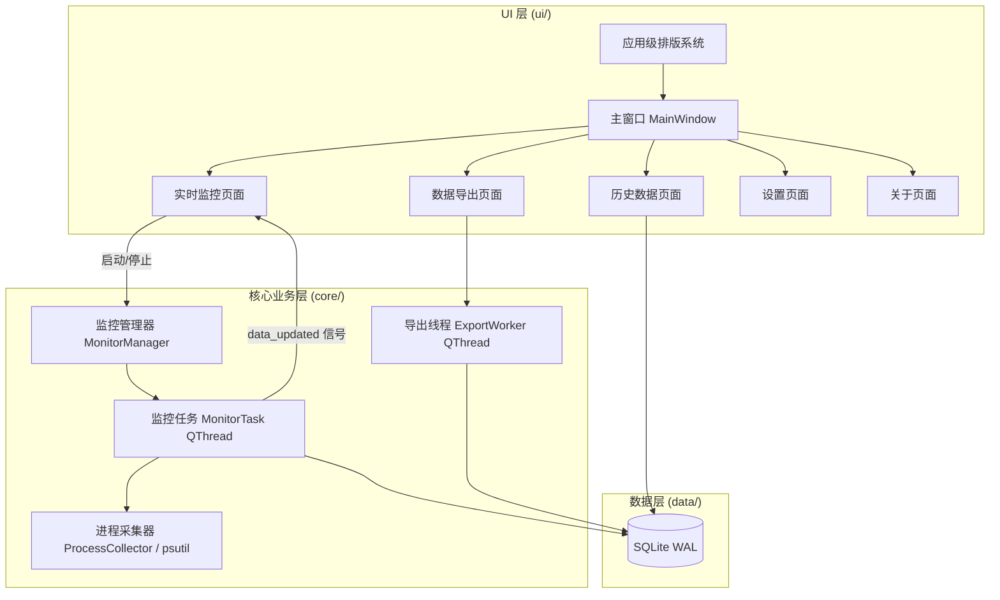

<div align="center">

# 进程监控助手 ProcessMonitor

一款轻量的 Windows 桌面工具，用于实时监控单个进程的资源占用、查看历史趋势并导出 CSV 数据。

[](https://github.com/liujialu0330/ProcessMonitor/actions/workflows/ci.yml)
[](https://github.com/liujialu0330/ProcessMonitor/releases)
[](https://github.com/liujialu0330/ProcessMonitor/releases)
[](https://github.com/liujialu0330/ProcessMonitor)
[](https://github.com/liujialu0330/ProcessMonitor)
[](./LICENSE)

[English](./README.md) | 简体中文



</div>

进程监控助手是一款 Windows 11 Fluent Design 风格的桌面应用，用于持续观察某个进程的运行状态。通过 PID 或从进程列表中选择目标进程后，可从内存、CPU、系统资源、I/O 四大类共 26 个指标中任意勾选，并以 1 秒到 1 小时之间任意整数秒的周期采集数据。所有采集结果会自动落库，既可以图表形式回放趋势，也可以表格形式逐条查看，还能一键导出为 CSV 做进一步分析。

## ✨ 功能特性

### 🧭 推荐用法：排查泄漏

1. 在“实时监控”页选择目标进程（默认勾选“泄漏排查”预设：私有字节、句柄、GDI 对象、USER 对象、线程数，并记住上次选择），可填写测试备注后开始监控
2. 让被测程序预热到稳定状态，点击卡片上的“打点”，写下“基线”
3. 每完成一轮被测操作（如打开关闭某个窗口 N 次）就打一个点，标签写清操作内容
4. 到“历史数据”页查看曲线上的打点竖线，以及统计条中的“变化量”和“增长速度”（每小时，最小二乘斜率）：每轮操作后持续上涨、且不回落，即是泄漏的典型特征

### 🔍 实时监控
- **26 个指标，4 大分类**：内存（工作集、私有字节、页面错误、唯一集大小等）、CPU（使用率、用户/内核时间、优先级）、系统资源（线程数、句柄数、GDI/USER 对象数、自愿上下文切换）、I/O（读写字节数与次数）；每项指标附一句说明，在指标选择窗口悬停即可查看
- **私有字节判断内存泄漏**：Windows 上原“虚拟内存”“提交大小”“专用工作集”数值完全相同，已合并为“私有字节”，是判断内存泄漏的主指标
- **采不到就留空，不记 0**：某指标无法采集时，任务卡片显示“不可用”并提示原因，该指标不写入数据。本工具未以管理员运行时，更高权限进程只有“唯一集大小”采不到；其他会话进程（如系统服务）的 GDI/USER 对象数显示“不支持”
- **较开始变化量与全程趋势**：任务卡片显示各指标相对开始时刻的变化量，迷你趋势图覆盖“任务开始至今”（长时间监控自动抽稀）
- **打点与备注**：可为任务写测试备注，运行中随时在卡片上打点（带标签）记录关键操作；停止监控前有确认，避免误点
- **稳妥的创建流程**：不默认选中进程；对同一 PID 重复创建会二次确认；支持按进程名或 PID 搜索
- **多指标、多任务**：单个任务可任意勾选指标并共用同一周期与时间戳；最多同时运行 5 个任务（配额只计运行中的任务）；采集周期 1~3600 秒任意整数，默认 1 秒
- **暂停/恢复**：可随时暂停某个任务而不丢失历史数据，恢复后立即采集一次
- **结束后卡片保留**：任务结束（含被测进程退出）后卡片保留，可“查看历史”“重新监控”或“关闭”；被测进程异常结束时弹出提示，窗口在后台时还会发托盘气泡
- **准时采样**：按单调时钟的截止时间调度，不随运行时间漂移；系统休眠唤醒后不补采；能识别 PID 被复用，不会把新进程当作原进程

### 📊 历史与导出
- **聚焦式历史工作区**：默认查看“全部”数据（泄漏判断需要看从开始至今的整体趋势），可快捷切换 10 分钟/1 小时/6 小时/24 小时；“趋势/明细”独立子视图；任务下拉显示时长、备注与“运行中”标记
- **统计条**：起点、当前、变化量、增长速度（每小时）、最小、最大
- **交互式历史图表**：悬停十字线读数、真实日期时间轴、打点竖线；纵轴刻度按显示单位取整，计数类指标使用整数刻度，平直曲线不会被放大成满幅波动；支持一键导出 PNG 或复制到剪贴板
- **运行中任务自动刷新**：图表与统计随采集自动更新，刷新间隔随数据量自适应
- **大数据量友好**：图表在数据库端分桶降采样（最多 2000 桶，每桶取最小/最大值，保留波峰波谷）；明细表显示“最近 2,000 条 / 共 N 条”，导出始终为全量
- **CSV 宽表导出**：每行一次采集、每个指标独立成列，末列为“打点”；任务信息中的数量使用千分位显示，切换任务会重置默认文件名，覆盖已有文件前确认；先写临时文件，成功后才替换目标文件，取消或失败不会留下半截文件；后台执行并支持取消
- **受控清理**：可从历史页“更多”菜单删除已停止任务的数据，需二次确认；有运行中任务时，数据库清理与压缩不可用

### ⚙️ 设置与个性化
- **主题**：浅色、深色或跟随系统，切换即时生效
- **统一排版**：Segoe UI / 微软雅黑字体栈，24px 页面标题与等宽数据文本
- **默认值与保留策略**：默认采集周期，以及历史数据保留策略（永久保留/7/30/90/180 天）
- **数据库维护**：查看占用大小，一键清理并压缩
- **系统托盘与关窗行为**：可选择关闭窗口时最小化到托盘，监控在后台继续；有任务在运行时直接关窗，会询问“停止并退出 / 最小化到托盘 / 取消”（注销或关机时不拦截）
- **单实例**：再次启动会激活已打开的窗口，而不是多开

### 🛡 稳定性与安全
- **自动更新**：启动时（或手动）检测 GitHub Release 新版本，非模态提示不打断操作；下载仅限 GitHub 官方域名，并校验安装包的 SHA-256，缺少校验信息时引导到发布页手动下载
- **抗崩溃存储**：SQLite 启用 WAL，数据落库失败自动重试，崩溃与异常自动记日志（5MB×5 滚动）；异常退出后再次启动会自动修正遗留的“运行中”任务
- **安全升级数据库**：升级在显式事务内进行，失败自动回滚并从备份还原，旧数据不丢
- **停止不卡界面**：停止监控、退出程序都不会阻塞界面，退出时保证已采数据全部落库
- **自动化测试**：400 多个用例覆盖数据层、迁移、采集与调度、导出、更新校验、各页面流程与界面契约；测试使用临时数据目录，不会触碰真实数据
- **实测性能**：77 万行规模的历史任务，打开耗时约 1.4 秒（v1.2.0 优化前为 3.4 秒；数据来自维护者本机实测）

## 📸 界面截图

| 实时监控 | 历史数据 |
|---|---|
|  |  |

| 数据导出 | 设置与关于 |
|---|---|
|  | <br> |

## 🚀 快速开始

### 普通用户

1. 前往 [Releases](https://github.com/liujialu0330/ProcessMonitor/releases) 下载最新安装包 `Windows_v*_Setup.exe`
2. 运行安装包，按向导完成安装（支持自定义安装目录）
3. 从开始菜单启动**进程监控助手**

覆盖安装新版本会保留原有的历史数据。

### 开发者

```bash
git clone https://github.com/liujialu0330/ProcessMonitor.git
cd ProcessMonitor
pip install -r requirements.txt
python main.py
```

### 补充说明

- **系统要求**：Windows 10/11（64位）；源码运行需 Python 3.8+（CI 与发布构建统一使用 3.11）
- **数据存储位置**：`%LOCALAPPDATA%\进程监控助手\data\monitor.db`（SQLite，已启用 WAL 模式）；日志位于 `%LOCALAPPDATA%\进程监控助手\logs\`
- **自动更新**：启动时或在"关于"页面手动检查 GitHub Release 新版本，可在应用内直接下载并启动安装程序

## 🏗 架构设计

项目采用 PyQt5 + PyQt-Fluent-Widgets 构建界面，psutil 采集进程指标，pyqtgraph 负责图表渲染，SQLite 负责数据持久化。整体分为 UI 层、核心业务层、数据层三层，层与层之间通过 Qt 信号槽机制通信，保证跨线程调用安全。



## 🛠 开发指南

```bash
python -m pytest tests/
```

- 用例清单可用 `pytest --collect-only -q` 查看；测试默认使用临时数据目录，也可用环境变量 `PROCESS_MONITOR_DATA_DIR` 指定运行时数据目录（日志随之写到该目录下的 `logs\`）
- 每次 push 和 PR 都会触发 CI 自动跑测试（见上方 CI 徽章）
- 打包为 Windows 安装包的完整说明见 [build/README_打包说明.md](build/README_打包说明.md)

## 🗺 后续规划

- [ ] 导出历史数据为 Excel 格式
- [ ] 多进程对比视图

完整版本历史见 [CHANGELOG.md](./CHANGELOG.md) 或 [GitHub Releases](https://github.com/liujialu0330/ProcessMonitor/releases)。

## 🤝 贡献指南

欢迎提交 Issue 与 Pull Request。提交 PR 前请确保本地 `python -m pytest tests/` 通过，并保证 CI 为绿色状态。

## 📄 许可证

本项目基于 [MIT License](./LICENSE) 开源。

维护者：[liujialu](https://github.com/liujialu0330)。
