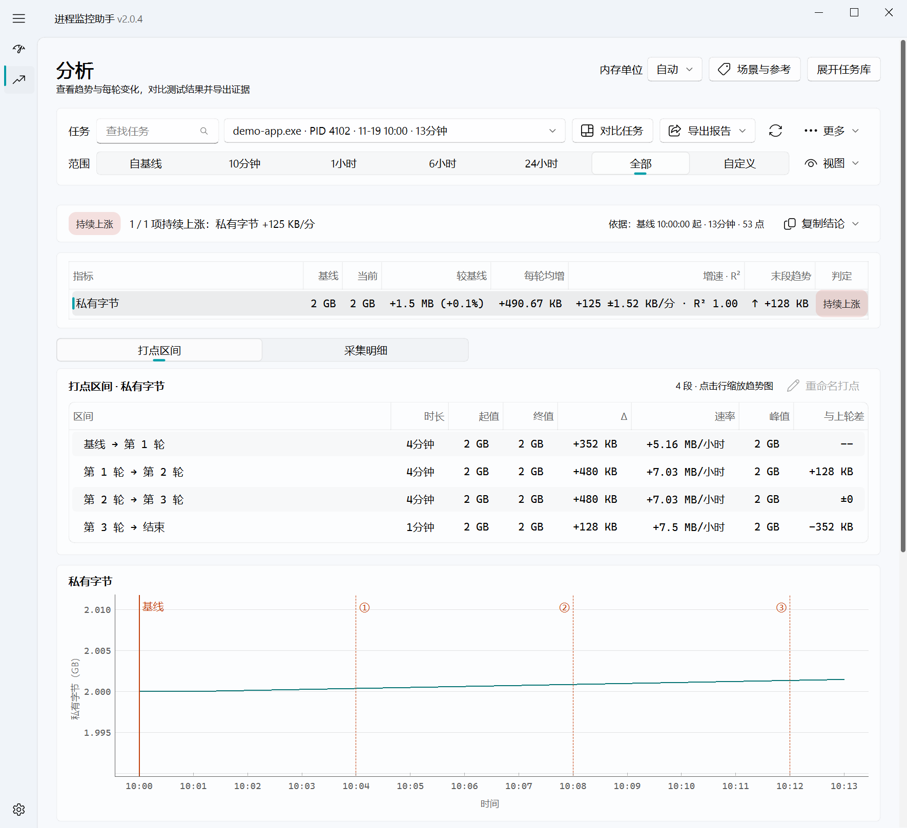
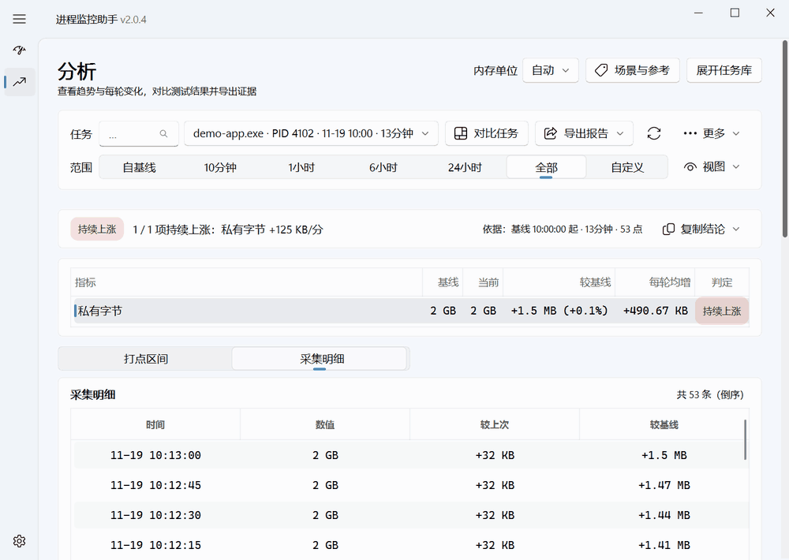
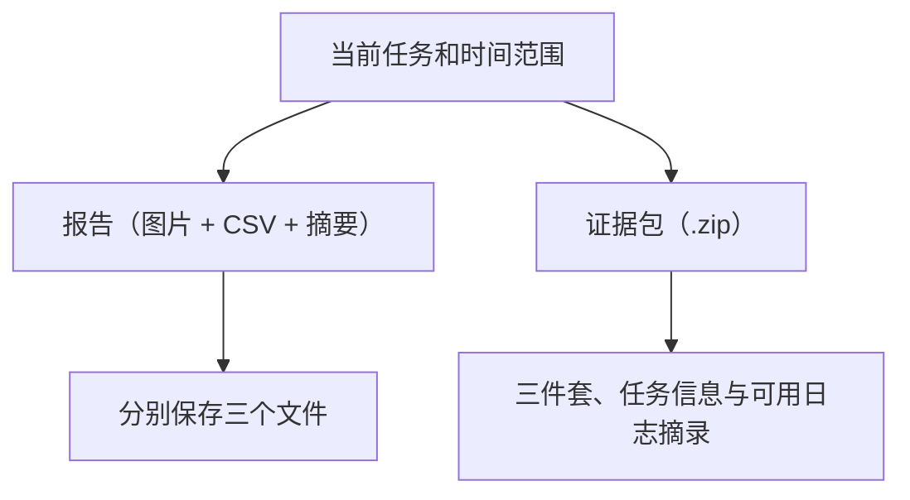

# 进程监控助手

记录 Windows 进程的内存、句柄和 GDI 对象等指标。给每轮测试打点，找出资源持续增长的阶段，并导出证据。

**[下载 Windows 安装包](https://github.com/liujialu0330/ProcessMonitor/releases/latest)** · Windows 10/11（64 位）

[快速开始](#快速开始) · [命令行](#命令行) · [English](README.md)

## 快速开始

在 [最新发布](https://github.com/liujialu0330/ProcessMonitor/releases/latest) 的 **Assets** 下载 `Windows_v*_Setup.exe`。运行安装向导后，从开始菜单打开「进程监控助手」。


1. **开始监控**。在「监控」页按进程名或 PID 选择目标，首次使用可选「泄漏排查」预设，点击「开始监控」。
2. **打基线和轮次点**。等目标程序运行稳定，在任务卡上点「打点」，确认默认名称「基线」。重复同一操作，每轮结束打一次点，例如每次打开再关闭同一个窗口。
3. **查看结果**。运行中点「分析」，或停止后点「查看分析」。先看「判定摘要」，再点「打点区间」中的一行，把趋势图定位到对应时段。



## 读懂结果

| 看哪里 | 怎么读 |
| --- | --- |
| 判定摘要 · 较基线 | 查看当前占用相对稳定时的变化。 |
| 打点区间 · Δ | 逐轮比较增量。反复增长是进一步复现和定位的线索。 |
| 判定摘要 · 数据不足 | 对可计算趋势的指标，继续采样至至少 30 个有效点，跨度达到 10 分钟和 30 个采样周期中的较长者。 |

### 看清几 KB 的增长

打开「分析 → 采集明细」，把页头「内存单位」切到 **KB**。下面的三个采样值在自动模式下都显示为 2 GB，切换后能看清差异。「较上次」按差值大小选单位。

| 私有字节示例（KB 模式） | 较上次 |
| ---: | ---: |
| 2,098,624 KB | +32 KB |
| 2,098,656 KB | +32 KB |
| 2,098,688 KB | +32 KB |



## 导出证据

在「分析」页选好任务和时间范围，等结果加载后点击「导出报告」。



选好导出类型和保存位置，完成后点「打开文件夹」查找文件。

## 命令行

在安装目录打开 PowerShell，将 `1234` 替换为目标进程 PID。该命令每分钟打点，约 15 分钟后停止并导出证据包到用户目录。

```powershell
.\pmctl.exe run --pid 1234 --metrics "memory_private,num_handles" --interval 1 `
  --rounds-every 60 --stop-after 900 `
  --evidence "$env:USERPROFILE\ProcessMonitorReports"
```

命令行开关位于「设置 → 监控默认值 → 允许命令行与脚本控制」。[等待启动、进程组与退出码](tools/README.md)

## 项目文档

| 想查什么 | 文档 |
| --- | --- |
| 各版本功能与升级说明 | [更新日志](CHANGELOG.md) · [发布页](https://github.com/liujialu0330/ProcessMonitor/releases) |
| 时间范围、指标口径和报告字段 | [产品需求与使用说明](doc/PRD_进程监控助手.md) |
| 源码结构和 Windows 安装包构建 | [代码架构](doc/代码架构说明.md) · [打包指南](build/README_打包说明.md) |

v2.0.4 安装版已支持内存单位切换和在区间表中重命名打点。[2.0.4 发布说明](doc/2.0.4发布说明.md)

<details>
<summary>从源码运行与测试</summary>

在项目根目录使用 Python 3.11。

```powershell
python -m pip install -r requirements-lock.txt
python main.py
```

运行与功能 CI 相同的用例范围。

```powershell
python -m pip install -r requirements-dev.txt
$env:QT_QPA_PLATFORM = 'offscreen'
$env:QT_QPA_FONTDIR = 'C:\Windows\Fonts'
$env:PYTHONIOENCODING = 'utf-8'
python -m pytest tests/ -m "not perf and not soak and not gui_real"
```

</details>

[问题反馈](https://github.com/liujialu0330/ProcessMonitor/issues) · [MIT 许可证](LICENSE)
