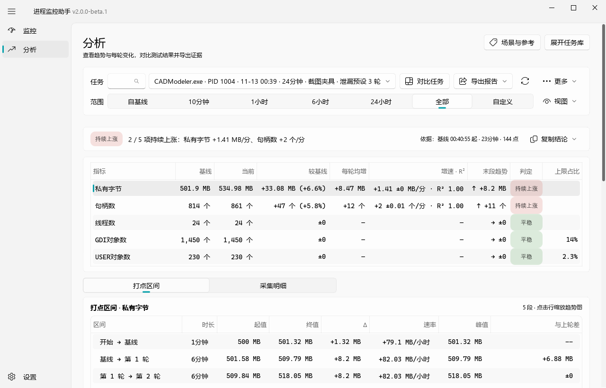
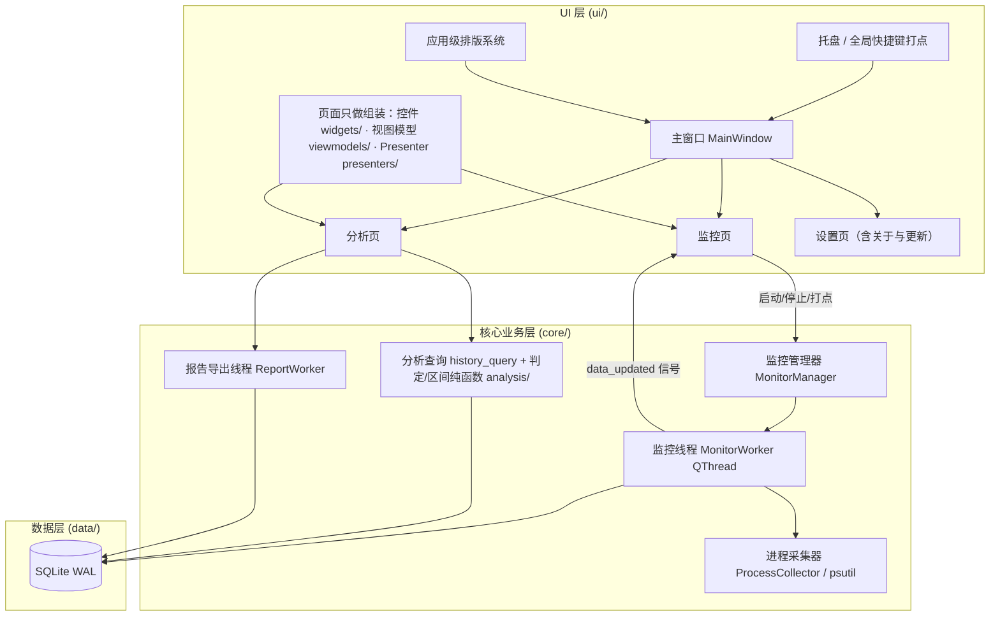

<div align="center">

# 进程监控助手 ProcessMonitor

一款轻量的 Windows 桌面工具，用于实时监控进程的资源占用、按“基线—打点”判定是否泄漏，并一键导出分析报告。

[](https://github.com/liujialu0330/ProcessMonitor/actions/workflows/ci.yml)
[](https://github.com/liujialu0330/ProcessMonitor/releases)
[](https://github.com/liujialu0330/ProcessMonitor/releases)
[](https://github.com/liujialu0330/ProcessMonitor)
[](https://github.com/liujialu0330/ProcessMonitor)
[](./LICENSE)

[English](./README.md) | 简体中文


</div>

## 2.0.2 版本

2.0.2 让运行中任务的分析结果、报告图片、CSV 与证据包共用同一份冻结数据边界，导出后新增的样本不会只混入文件而与界面结论不一致；同时修复了监控页“方案”和任务操作菜单刚弹出就消失的问题，以及设置页卡片重复布局和动态显隐后的裁剪问题，详见 [2.0.2 修复验收](doc/2.0.2修复验收.md)。

2.0.1 修复了点击设置页分组导航时弹出异常的问题。七个分组均已通过真实鼠标点击回归和桌面交互检查，详见 [修复验收](doc/2.0.1修复验收.md)。

`2.0.0` 增加进程树/同名进程组、自动化打点与停止、崩溃取证和重启续采、证据包、完整测试方案、最多四任务对比及场景参考基线。监控页提供卡片和列表视图，任务库支持搜索、标星与批量删除。

首次运行会把旧库迁移到 v5 并保留 `.bak_v1` 备份，大库需要等待迁移完成；默认数据目录不变。升级前应保留足够磁盘空间，完整升级与回退说明见 [更新日志](CHANGELOG.md)。

可下载 [2.0.2 安装包](https://github.com/liujialu0330/ProcessMonitor/releases/tag/v2.0.2)，或从 1.4.1、2.0.0、2.0.1 中检查更新。2.0.0 用户可用滚轮到设置页底部找到更新按钮。功能回归、远端 CI、性能、安装卸载与 A/B 回退验证已有通过记录；其余 24 小时长测、真机专项和多人内测未执行，不计为通过。原2.0范围见 [验收记录](doc/2.0.0验收记录.md)，最新补丁修复见 [2.0.2 修复验收](doc/2.0.2修复验收.md)。

```bat
python main.py
python pmctl.py start --plan D:\plans\window-cycle.json
python pmctl.py verdict --task TASK_ID --vs-reference
```

方案可在监控页保存、导入和导出；备注最多 2000 个字符，等待超时支持小数秒，留空表示不限时。`pmctl` 重定向输出统一使用 UTF-8，`--json` 的中文与 emoji 使用标准转义。命令行参数与方案示例见 [自动化使用说明](tools/README.md)。


进程监控助手是一款 Windows 11 Fluent Design 风格的桌面应用，用于持续观察某个进程的运行状态。通过 PID 或从进程列表中选择目标进程后，可从内存、CPU、系统资源、I/O 四大类共 26 个指标中任意勾选，并以 1 秒到 1 小时之间任意整数秒的周期采集数据。所有采集结果会自动落库；在“分析”页可以看到每个指标的判定结论、逐轮增量与趋势图，也可以把最多四次测试放在一起对比，并一键导出报告图片与 CSV。

## ✨ 功能特性

### 🧭 推荐用法：排查泄漏

1. 在“监控”页选择目标进程（默认勾选“泄漏排查”预设：私有字节、句柄、GDI 对象、USER 对象、线程数，并记住上次选择），可填写测试备注后开始监控；被测程序还没启动时，勾选“等待进程启动后自动开始”
2. 让被测程序预热到稳定状态，打第一个点——默认名称就是“基线”
3. 每完成一轮被测操作（如打开关闭某个窗口 N 次）就打一个点，默认依次命名为“第 1 轮”“第 2 轮”…；手在被测程序上时，直接按全局快捷键 Ctrl+Alt+M 或用托盘菜单“打点”，不必切回本窗口
4. 到“分析”页看判定摘要：每个指标的较基线变化、每轮均增、增速（带置信区间与 R²）和判定（持续上涨 / 平稳 / 波动 / 数据不足）；打点区间表逐轮列出增量，每轮都涨且不回落即是泄漏的典型特征
5. 一键“导出报告”，得到报告图片、明细 CSV 与摘要 CSV 三个文件，直接附到缺陷单里

### 🔍 监控
- **26 个指标，4 大分类**：内存（工作集、私有字节、页面错误、独占物理内存（USS）等）、CPU（使用率、用户/内核时间、基本优先级）、系统资源（线程数、句柄数、GDI/USER 对象数、自愿上下文切换）、I/O（读写字节数与次数）；指标名与任务管理器一致，每项附一句说明，在指标选择窗口悬停即可查看
- **私有字节判断内存泄漏**：Windows 上原“虚拟内存”“提交大小”“专用工作集”数值完全相同，已合并为“私有字节”，是判断内存泄漏的主指标
- **采不到就留空，不记 0**：某指标无法采集时，任务卡片显示“不可用”并提示原因，该指标不写入数据。可用性取决于进程权限、会话和系统接口，提权后仍按实际采集结果显示；其他会话进程（如系统服务）的 GDI/USER 对象数显示“不支持”
- **一眼看清的任务卡片**：状态胶囊（运行中 / 已暂停 / 已结束 / 异常结束）与已运行时长；各指标显示“较基线”（基线后 5 个样本的中位数）或“比开始时”的变化；迷你趋势图覆盖“任务开始至今”并画出打点刻度
- **打点不打断操作**：卡片“打点”、托盘菜单“打点”、全局快捷键（默认 Ctrl+Alt+M，可在设置页修改）三个入口，默认名称按“基线 / 第 N 轮”自动编号；暂停/恢复时自动记下系统打点
- **等待进程启动**：被测程序还没运行时先开始等待，进程一出现就自动按所选配置开始监控，适合从启动阶段观察
- **稳妥的创建流程**：不默认选中进程；对同一 PID 重复创建会二次确认；一个搜索框既可按进程名搜索，也可直接输入 PID（F5 刷新进程列表、Ctrl+F 聚焦搜索框，切回窗口时自动刷新）；已有任务时新建表单折叠成一行
- **多指标、多任务**：单个任务可任意勾选指标并共用同一周期与时间戳；最多同时运行 5 个任务（配额只计运行中的任务）；采集周期 1~3600 秒任意整数，默认 1 秒
- **暂停/恢复**：可随时暂停某个任务而不丢失历史数据，恢复后立即采集一次
- **结束后保留**：任务结束（含被测进程退出）后收进“已结束”分组的一行，可“查看分析”“同配置再测”“关闭”或一键“清除全部”；被测进程异常结束时弹出提示，窗口在后台时还会发托盘气泡
- **准时采样**：按单调时钟的截止时间调度，不随运行时间漂移；系统休眠唤醒后不补采；能识别 PID 被复用，不会把新进程当作原进程

### 📊 分析与报告
- **判定摘要表**：每个指标一行——基线、当前、较基线、每轮均增、增速 ±置信区间 · R²、末段趋势、判定、GDI/USER 上限占比，并写明统计依据（如“基线 16:37:33 起 · 2小时15分 · 8,100 点”）；样本不足（少于 30 点或跨度不足）时明确显示“数据不足”，不给吓人的外推数字
- **合理的统计口径**：存在基线时只统计基线之后的数据；累计类指标（CPU 时间、I/O 字节与次数等）画每秒速率、显示平均速率，不外推增速；峰值类指标显示抬升次数；采集中断处曲线断开并加阴影
- **趋势图**：每个指标一张小图（也可叠加为 Δ% 一张图），十字线联动、最小/最大值带保留波峰波谷；横轴可切换绝对/相对时间；底部概览条拖动选区即按选区重新统计；在图上右键可补打点、设为基线、重命名或删除打点
- **打点区间**：按基线与各轮打点切段，逐轮列出时长、起止值、增量、速率、峰值与“与上轮差”，点击即缩放到该段；另有采集明细（含较上次、较基线）
- **任务对比**：选第二个任务（如修复前后），同一指标相对各自起点的变化叠加在相对时间轴上，并排列出两边的分轮增量
- **一键导出报告**：报告图片（结论 + 多指标小倍数图）、明细 CSV（元数据行、已运行秒数、中断处空行、末列打点）、指标 × 打点区间摘要 CSV 三件套；也可只导出 CSV、只导出图片或复制图片；先写临时文件、成功后才替换目标，后台执行，完成后点击才打开文件夹
- **运行中任务自动刷新**：分析页随采集自动更新，刷新间隔随数据量自适应；所有加载在后台执行，大数据量下操作不卡界面
- **受控清理**：可从分析页“更多”菜单删除已结束任务的数据，需二次确认；有运行中任务或导出进行中时，数据库清理与压缩不可用

### ⚙️ 设置与个性化
- **主题**：浅色、深色或跟随系统，切换即时生效
- **统一排版**：Segoe UI / 微软雅黑字体栈，24px 页面标题与等宽数据文本
- **默认值与保留策略**：默认采集周期，以及历史数据保留策略（永久保留/7/30/90/180 天）
- **打点快捷键**：在设置页直接按下组合键即可修改，清空即不使用；被其他程序占用时说明原因
- **数据库维护**：查看占用大小，一键压缩（或按保留策略清理并压缩）
- **系统托盘与关窗行为**：可选择关闭窗口时最小化到托盘，监控在后台继续；有任务在运行时直接关窗，会询问“停止并退出 / 最小化到托盘 / 取消”（注销或关机时不拦截）
- **关于与更新**：版本信息与检查更新并入设置页
- **单实例**：再次启动会激活已打开的窗口，而不是多开

### 🛡 稳定性与安全
- **自动更新**：启动时（或手动）检测 GitHub Release 新版本，非模态提示不打断操作；下载仅限 GitHub 官方域名，并校验安装包的 SHA-256，缺少校验信息时引导到发布页手动下载
- **抗崩溃存储**：SQLite 启用 WAL，数据落库失败自动重试，崩溃与异常自动记日志（5MB×5 滚动）；异常退出后再次启动会自动修正遗留的“运行中”任务
- **安全升级数据库**：升级在显式事务内进行，失败自动回滚并从备份还原，旧数据不丢
- **停止不卡界面**：停止监控、退出程序都不会阻塞界面，退出时保证已采数据全部落库
- **自动化测试**：4,700 多个用例覆盖数据层、迁移、采集与调度、判定与区间统计、报告导出、全局快捷键（假后端）、更新校验、各页面流程与界面契约，并有一条离屏冒烟走完“开始 → 基线 → 两轮打点 → 分析 → 导出报告 → 关窗”；测试使用临时数据目录，不会触碰真实数据
- **实测性能**：77 万行规模的历史任务，打开耗时约 1.4 秒（v1.2.0 优化前为 3.4 秒；数据来自维护者本机实测）

## 📸 界面截图

| 监控 | 分析 |
|---|---|
|  |  |

| 设置（含关于与更新） |
|---|
|  |

## 🚀 快速开始

### 普通用户

1. 前往 [Releases](https://github.com/liujialu0330/ProcessMonitor/releases) 下载最新安装包 `Windows_v*_Setup.exe`
2. 运行安装包，按向导完成安装（支持自定义安装目录）
3. 从开始菜单启动**进程监控助手**

覆盖安装新版本会保留原有的历史数据。

### 开发者

```bash
git clone https://github.com/liujialu0330/ProcessMonitor.git
cd ProcessMonitor
pip install -r requirements.txt
python main.py
```

### 补充说明

- **系统要求**：Windows 10/11（64位）；源码与锁定依赖使用 Python 3.11，CI 已在 3.11.9 验证
- **数据存储位置**：`%LOCALAPPDATA%\进程监控助手\data\monitor.db`（SQLite，已启用 WAL 模式）；日志位于 `%LOCALAPPDATA%\进程监控助手\logs\`
- **自动更新**：启动时或在“设置 → 关于与更新”中手动检查 GitHub Release 新版本，可在应用内直接下载并启动安装程序

## 🏗 架构设计

项目采用 PyQt5 + PyQt-Fluent-Widgets 构建界面，psutil 采集进程指标，pyqtgraph 负责图表渲染，SQLite 负责数据持久化。整体分为 UI 层、核心业务层、数据层三层，层与层之间通过 Qt 信号槽机制通信，保证跨线程调用安全。详细结构见 [doc/代码架构说明.md](doc/代码架构说明.md)。



## 🛠 开发指南

```bash
python -m pytest tests/
```

- 用例清单可用 `pytest --collect-only -q` 查看；测试默认使用临时数据目录，也可用环境变量 `PROCESS_MONITOR_DATA_DIR` 指定运行时数据目录（日志随之写到该目录下的 `logs\`）
- 推送到 `main` 或 `codex/release-validation-*` 分支、面向 `main` 的 PR，以及手动触发时运行功能 CI（见上方 CI 徽章）
- 打包为 Windows 安装包的完整说明见 [build/README_打包说明.md](build/README_打包说明.md)

## 🗺 后续规划

- [ ] 导出数据为 Excel 格式
- [x] 最多四任务对比（v2.0.0）
- 阈值告警暂不纳入范围

完整版本历史见 [CHANGELOG.md](./CHANGELOG.md) 或 [GitHub Releases](https://github.com/liujialu0330/ProcessMonitor/releases)。

## 🤝 贡献指南

欢迎提交 Issue 与 Pull Request。提交 PR 前请确保本地 `python -m pytest tests/` 通过，并保证 CI 为绿色状态。

## 📄 许可证

本项目基于 [MIT License](./LICENSE) 开源。

维护者：[liujialu](https://github.com/liujialu0330)。
